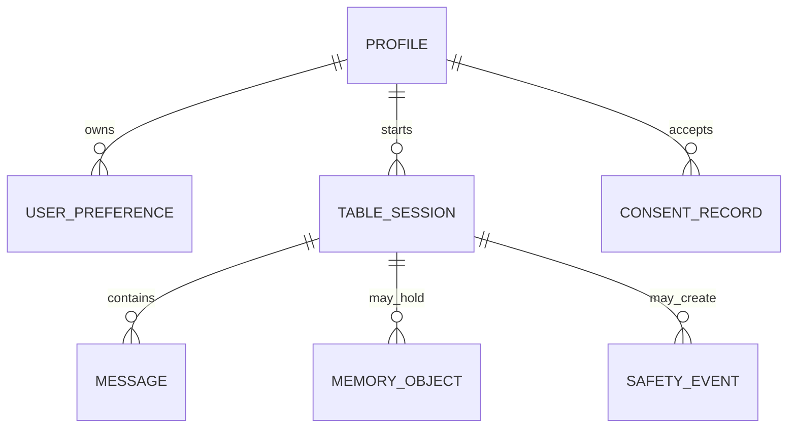

# Architecture and data review · 2026-10-27

## Actual implementation

| Area | Status | Evidence |
| --- | --- | --- |
| Framework | Implemented | Next.js 15.5, React 19, TypeScript, App Router |
| Styling | Implemented | CSS custom properties plus Tailwind import; no component framework |
| 3D | Implemented prototype | raw Three.js scene with Canvas fallback; no GLB loader, R3F or Motion |
| AI | Implemented / credential-dependent | Anthropic SDK route, Zod validation, TurnPlan tool protocol, local Mock without API key |
| Retrieval | Implemented | local BM25 index, query expansion, optional Voyage vectors |
| Safety | Implemented guardrails | crisis bypass, banned-language stream filter, deterministic safety eval |
| Rate limit | Implemented but deployment-dependent | in-memory fallback, optional Upstash REST store |
| Database / auth | Missing by design | no client, schema, migration, identity or persistent messages |

The chat route emits SSE events, but the real Anthropic call currently completes a TurnPlan before it emits text. This is an event protocol, not verified token-by-token upstream streaming. Mock mode is explicitly local and not a model evaluation.

## Current API contract

| Route | Input | Behaviour | Boundary |
| --- | --- | --- | --- |
| POST /api/chat | persona, bounded messages, optional still life and memory object | validates, rate-limits, safety-checks, retrieves sources, sends TurnPlan/SSE | Browser-supplied assistant turns are discarded; only recent user text is sent to a provider |
| POST /api/dish | base64 image and media type | validates, rate-limits real model calls, returns neutral visual properties | no calorie, weight, quantity, body or diagnostic output |

Every request is stateless. “Tables are isolated” currently means no application database exists from which cross-table context can be read. This is stronger than a client-side tab filter for the prototype, but it does not provide a persistent, multi-user privacy guarantee.

## Proposed production boundary — not implemented

Suggested minimum tables: profiles, user_preferences, table_sessions, messages, memory_objects, consent_records, safety_events and deletion_jobs. Use UUID primary keys, a profile_id foreign key and a table_session_id foreign key on every conversation-related row. Row-level security must scope every read and write to the authenticated owner and current session. Memory objects must remain separate from a chronological message timeline.

Suggested retention policy: default anonymous sessions are ephemeral; accounts opt into persistence; images never become memory automatically; consent records carry policy version; deletion creates a queued, auditable request with a defined backup expiry. This is an architecture proposal, not a claim that the current deploy has these protections.

## Security and privacy review

- Provider keys remain server-side in environment variables; none are exposed to browser code.
- Conversation context is capped at 6,000 recent user characters. Client assistant messages do not become provider authority.
- The application code does not persist chats, images or memory objects. Hosting, error and proxy logs still require deployment-owner review.
- Upstash absence makes rate limiting per-instance and fail-open if its store fails. Production needs shared storage, alerting and an explicit availability decision.
- No authenticated identity means there is no verified ownership, deletion API, cross-device sync or persistent session isolation.

## Deployment and cost

The build generates a 6.5MB local retrieval index and traces it into the chat function. Production needs ANTHROPIC_API_KEY; Voyage and Upstash are optional but recommended for semantic recall and shared limits. There is no Vercel configuration file; CI runs typecheck, index, tests and retrieval/contract evaluations on GitHub Actions.
